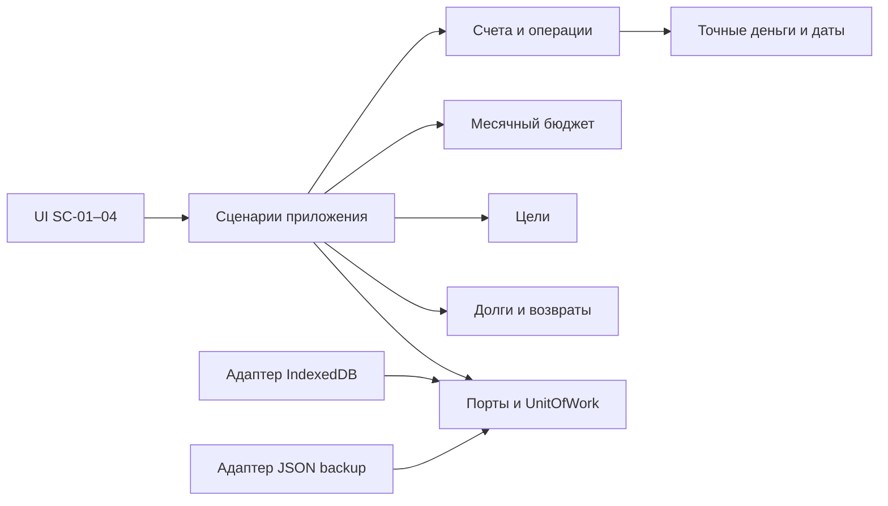

# Техническая структура — APP-001-TECH-SYS v1

Дата: 30 октября 2026. Автор: system-architect; проверяющий: architecture-lead.
Статус: предложение для проверки главы, финансового отдела, независимого QA и суда; реализации нет.
Входы: AGENTS.md, team/PROTOCOL.md, профиль system-architect, CONCEPT.md v0.1, SCREENS.md v1.
Подтверждено U-01–03: структура и примерный дизайн личных финансов; предложена работа в Figma.
Web, один пользователь, ручной ввод, React/TypeScript, local-first и KZT/2 — предложения, не выбор пользователя.
Все финансовые инварианты ниже — кандидаты H-02–06/H-09 до отдельной проверки финансовым отделом по Q-02–04.

## Архитектурное решение и границы

Предлагается один адаптивный клиент, один локальный набор данных, четыре раздела SC-01–04; без сервера на первом этапе.
Разделение — модули внутри приложения, без микросервисов, общего event bus и отдельного сервиса расчётов.
- `presentation`: страницы, формы, фильтры, форматирование, доступность; не рассчитывает деньги и не обращается к IndexedDB.
- `application`: команды/запросы, сценарии S-01–06, границы транзакций, валидация входных DTO, обработка конфликтов.
- `domain/money-time`: точные Money, даты/периоды, сопоставление валют, чистые функции; без React и браузерных API.
- `domain/ledger`: счета, категории, доходы/расходы/переводы и движения по счетам; единственный источник денежных операций.
- `domain/budget`: месячные планы и факт из ledger; не создаёт операции и не меняет баланс счёта.
- `domain/goals`: цель и ручное накопление; не изменяет ledger.
- `domain/debts`: направления долга, исходная сумма и возвраты; не изменяет ledger.
- `domain/overview`: чистые запросы над перечисленными модулями; не хранит второй независимый баланс или итог.
- `ports`: Repository, UnitOfWork, Clock, BackupStore; реализации передаются application извне.
- `infrastructure`: IndexedDB-адаптеры, миграции и JSON backup; знает DTO и порты, не определяет финансовые формулы.
Зависимости: presentation → application → domain/ports; infrastructure → ports/domain; сборка приложения соединяет адаптеры.
Кросс-модульные записи выполняет application через UnitOfWork; UI получает единый результат после commit.

Предлагаемая схема модулей; приложение по ней ещё не создано:


## Типы и сериализация без потери точности

- `MoneyDTO = {currency: CurrencyCode, scale: integer, amount: string}`; демо `{currency:"KZT",scale:2,amount:"1234.50"}`.
- `amount` — каноническая десятичная строка без разделителей групп, экспоненты, `+`, ведущих нулей и отрицательного нуля; дробная часть ровно `scale` знаков.
- В domain Money содержит `minor: bigint`; пример выше → `123450n`. DTO/storage/backup используют только строки, не JSON BigInt.
- Строковый ввод с запятой локализуется в DTO; дробная часть дополняется нулями, превышение scale отклоняется, не обрезается.
- Арифметика: bigint минимальных единиц; никакого `Number`/`parseFloat`/преобразования Money в float даже для форматирования.
- Сложение/сравнение разрешено только при совпадении currency и scale; scale выбирается из явного реестра валют, не из произвольного ввода.
- Для демо scale=2 — договорённость макета, не утверждение валютного законодательства. Предел длины/суммы уточнить в Q-02 до реализации.
- Сложение/вычитание не округляются; деления денег и конвертации в MVP нет. Округление процентов прогресса/диаграмм отдельно согласует финансовый отдел.
- `LocalDate = YYYY-MM-DD`: реальная календарная дата без времени и UTC-преобразования; regex недостаточен, проверяется календарь.
- `Month = YYYY-MM`; период `[первое число месяца, первое число следующего месяца)`, включение операции по её LocalDate.
- Настраиваемая зона влияет только на значение «сегодня»/месяц по умолчанию; выбранные вручную даты от смены зоны не сдвигаются (Q-02).
- `createdAt`/`updatedAt` — отдельные UTC timestamps метаданных; не участвуют в отнесении операции к месяцу.
- Все сущности: стабильный `id`, `revision`; импортированные значения рассматриваются как unknown до полной runtime-валидации.

## Сущности и предлагаемые инварианты

- `Account`: id, name, currency/scale, archived, opening: null либо {amount, date}; null означает «начальный баланс не задан». При наличии операций currency/scale неизменны.
- Opening — баланс перед движениями date; при известном opening операции счёта имеют дату не раньше date. Более ранняя запись требует явного уточнения baseline, без скрытого пересчёта.
- Известный баланс на d = opening + сумма подписанных движений от opening.date по d включительно; до opening.date он неизвестен.
- При opening=null баланс неизвестен, даже если операции есть; суммы доходов/расходов периода при этом доступны. Итог счетов с неизвестным балансом не выдаётся за полный.
- `Category`: id, name, kind income/expense, archived. Использованные счета/категории архивируются; ссылки не обрываются удалением.
- `Operation`: id, type income/expense/transfer, date, положительная Money, заметка; income/expense имеют accountId и categoryId соответствующего kind.
- Валюта операции совпадает со счётом; отрицательный знак движения определяется type, не вводится пользователем в сумму операции.
- Transfer имеет fromAccountId≠toAccountId, одинаковые валюту/scale двух счетов и единую положительную сумму; категории нет.
- Перевод — один агрегат: два движения `−amount` и `+amount`, сумма движений по его валюте = 0; не доход/расход и не факт бюджета.
- Создание/редактирование/удаление перевода целиком атомарно. Ошибка записи не оставляет одну сторону перевода.
- Редактирование Operation сохраняет id и повышает revision; дата/сумма/счёт меняются одной командой с expectedRevision.
- Перенос расхода из октября в ноябрь убирает факт из октября, добавляет в ноябрь, обновляет затронутые остатки; не создаёт второй расход.
- Производные итоги рассчитываются из одной committed revision; кэши обоих месяцев/счетов инвалидируются после commit, частично обновлённый обзор не показывается.
- Удаление после подтверждения убирает все движения операции; отсутствующие ссылки, несовпадение валют и конфликт revision блокируют всю команду.
- `Budget`: ключ month+currency/scale; discriminator `mode: total | category`. Один режим на ключ, без суммирования общего и категорийного лимита.
- `total`: заданный неотрицательный limit; spent = все расходы этой валюты/месяца; remaining = limit−spent.
- `category`: map categoryId→неотрицательный plan; planned = сумма заданных планов; spent = все расходы месяца, включая категории без плана.
- Для category remaining = planned−spent; непланированные расходы видны отдельно. У категории без плана plan/remaining=null, её spent не пропадает.
- Budget отсутствует → «Не настроен», remaining=null; явный limit/plan=0 — настроенный нулевой лимит. remaining может быть отрицательным.
- Категорийный subtotal и общий spent — два представления одних расходов, их не складывают. Категории бюджета соответствуют expense и не дублируются.
- Остаток бюджета не баланс и не обещание доступных денег; перенос лимита/остатка в следующий месяц не выполняется автоматически (Q-03).
- `Goal`: id, name, target>0, accumulated≥0, currency/scale, optional dueDate; ручное изменение accumulated не создаёт операцию.
- Кандидат поведения при accumulated>target: сохранить сумму, подписать превышение; визуальное ограничение полосы не изменяет деньги. Решение открыто в Q-04.
- `Debt`: id, direction owe/owedToMe, label, principal>0, currency/scale, optional dueDate; `Repayment`: id, debtId, date, amount>0.
- Кандидат: сумма возвратов≤principal; outstanding=principal−сумма возвратов; редактирование/удаление возврата пересчитывает остаток в одной транзакции.
- Исходная сумма/валюта долга не меняется так, чтобы нарушить сохранённые возвраты; направления owe/owedToMe показываются отдельно, не взаимозачитываются.
- Создание долга/возврата не меняет счёт, доход, расход, бюджет или цель; процентов, штрафов и кредитных графиков нет (H-06/H-08, Q-04).
- Сводки валют разделены. D1 переносится без преобразования: доход 500000.00, расход 300000.00, план 350000.00, остаток бюджета 50000.00 KZT.

## Хранение, атомарность и ошибки

- Предлагается одна IndexedDB: stores accounts/categories/operations/budgets/goals/debts/repayments/meta; записи разделены datasetId, ключи/индексы включают datasetId. Money хранится DTO.
- meta содержит schemaVersion, activeDatasetId и activeRevision; UnitOfWork проверяет ожидаемые datasetId/revision внутри readwrite-транзакции и изменяет затронутые stores плюс revision целиком.
- Успешное сохранение показывается после transaction.complete, не после request.success; при abort остаются прежние данные и введённые значения формы. Это следует из [IndexedDB, lifecycle](https://www.w3.org/TR/IndexedDB/#transaction-lifecycle).
- Будущий backup: versioned JSON с schemaVersion/dataRevision и MoneyDTO; экспорт — readonly-снимок meta и всех stores одной activeRevision/activeDatasetId; dataRevision=activeRevision снимка.
- Импорт full-replace: parse → schema/runtime/reference/invariant/size validation → предпросмотр с фиксацией исходных activeDatasetId/revision → подтверждение замены → новый локальный staging datasetId в этой БД → полная запись и статус ready → атомарная активация.
- Активация проверяет ready и неизменность исходных activeDatasetId/revision в одной readwrite-транзакции meta, затем меняет activeDatasetId/revision и previousDatasetId вместе; текущие reads/writes проверяют activeDatasetId/revision в своих транзакциях.
- Хранится одна previous-версия до явной очистки или следующей успешной замены; срок не утверждён (Q-05). Нужен квотный запас для active/previous/staging одновременно: при нехватке импорт отклоняется до активации. Абсолютная защита от очистки браузера не обещается.
- Неизвестная версия, повреждение, неполный перевод, ошибочная Money/дата или нехватка места отменяют весь импорт; старую версию не удаляют до успешной активации.
- Ошибки application: VALIDATION(field/code), CURRENCY_MISMATCH, REFERENCE_MISSING, CONFLICT, STORAGE_UNAVAILABLE, QUOTA, IMPORT_INVALID/UNSUPPORTED_VERSION, MIGRATION_FAILED.
- Ошибки нормализуются адаптером, не выводятся сырыми stack traces; UI различает loading/empty/error/saving/saved и не заменяет ошибку нулём.
- Конкурирующие вкладки сверяют datasetId/revision внутри транзакции; stale-write отклоняется, затем перечитываются данные. BroadcastChannel — только уведомление, не механизм целостности.
- Local-first относится к данным; запуск без сети требует отдельно спроектированного кэширования ресурсов. Service worker/offline-ready сейчас не обещаются.
- Срок хранения, восстановление, удаление, лимиты импорта и защита данных детализируются в SECURITY.md; Q-05 остаётся открытым.

## Предлагаемая структура будущего кода

```text
src/app/                   # сборка, навигация, зависимости, настройки зоны/локали
src/presentation/pages/    # overview, operations, goals, debts
src/presentation/ui/       # MoneyField, формы, состояния, компоненты доступности
src/application/           # commands, queries, DTO validation, ports, UnitOfWork
src/domain/                # money-time, ledger, budget, goals, debts, overview
src/infrastructure/        # indexeddb, migrations, backup, clock
tests/                     # независимые денежные эталоны, storage integration, e2e
docs/                      # продукт, архитектура, дизайн, результаты проверки
```

## Стек, этапы и условия реализации

- Кандидат: TypeScript strict + React для представления; [официальная модель React](https://react.dev/learn/thinking-in-react) описывает компоненты/состояния. Клиентская SPA предлагается из-за отсутствия SSR/backend в первом MVP; версии/сборщик выбираются после Q-01.
- TypeScript не заменяет runtime-валидацию DTO: type assertions удаляются при компиляции, согласно [TypeScript Handbook](https://www.typescriptlang.org/docs/handbook/2/everyday-types.html#type-assertions).
- Кандидат: нативный IndexedDB через собственный тонкий адаптер; API транзакций проверен по [W3C IndexedDB](https://www.w3.org/TR/IndexedDB/). Целевые браузеры, включая поддержку BigInt/IndexedDB, ещё предстоит проверить; версии не выбраны.
- Этап 0: согласовать Q-01–05 и финансовые правила; утвердить D1/контракты/макеты и пределы ввода. Q-06 о месте Figma решает отдельный процесс дизайна.
- Этап 1: money/date/domain и эталоны → ledger/счета/категории → атомарное хранение, миграции, backup/restore → SC-01/02 и бюджет.
- Этап 2: независимые goal/debt-модули → SC-03/04 → адаптивность, состояния, доступность; цели/долги связать со счетами только после решения Q-04.
- Этап 3: независимый QA по согласованным сценариям и суд по фиксированной версии; backend/auth/sync — отдельная будущая задача, не скрытая часть MVP.
- Будущая проверка: точный round-trip Money; границы месяца/високосный день; edit October→November; abort перевода; unknown opening; нулевой/отсутствующий бюджет; импорт/конфликт revision.
- Фактическая проверка сейчас — чтение входов/официальных источников и проверка документа. Код, зависимости, браузерные сценарии, миграции и финансовые тесты не запускались: приложения нет.
- Передача главе: проверить согласованность с SECURITY.md и продуктом; финансовые кандидаты не считать утверждёнными до отдельной верификации Q-02–04.
