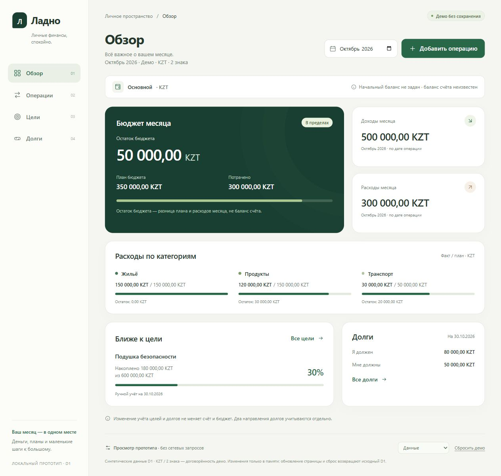
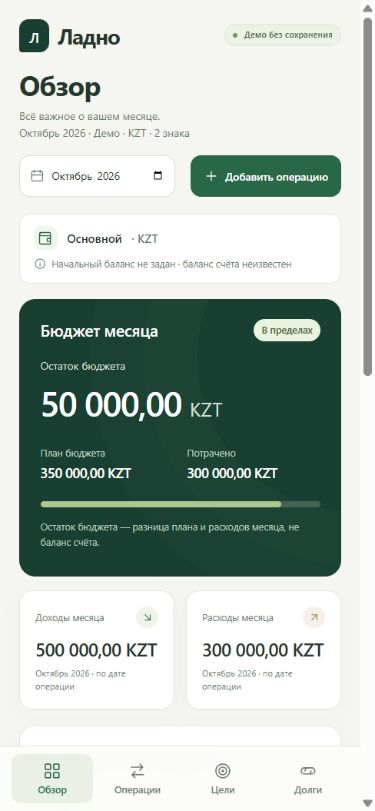

# Проверка интерфейсного отдела — APP-003

Дата: 02.11.2026, Asia/Qyzylorda. Проверяющий: `/root/local_prototype_frontend`, frontend-lead; подчинение: chief.
Версия: APP-003-frontend v1, шесть SHA-256 ниже. Статус: **проверка главы пройдена; рекомендуется передача независимому QA**. Это не финальная приёмка приложения: независимые QA и суд — отдельные последующие этапы.

## Задача, входы и владельцы

Пользователь выбрал локальный интерактивный прототип личных финансов вместо продолжения Figma. Это демонстрационный дизайн, работающий в памяти, а не production-приложение. Установка зависимостей, публикация и долговременное хранение не входят в задачу.
Прочитаны AGENTS.md, team/PROTOCOL.md, полный профиль frontend-lead, APP-003, CONCEPT, SCREENS, MODEL, D1, UX, UX-REVIEW-V2 и креативный HEAD_REVIEW-V2. Глава просмотрел прежний SC-01 PNG как визуальный вход; новым доказательством реализации он не является.

- `/root/local_prototype_frontend/interface`, interface-engineer: только новые `prototype/index.html`, `prototype/styles.css`, `prototype/view.js`; представление, адаптация и разметка форм.
- `/root/local_prototype_frontend/interaction`, interaction-engineer: только новые `prototype/demo-data.js`, `prototype/model.js`, `prototype/app.js`; точные деньги, состояние, валидация и события.
- Глава: этот отчёт; начальник отдельно разрешил два новых `docs/frontend/proofs/*.jpg`. Исходный код за специалистов не пишет и не исправляет; замечания возвращает владельцам.

Оба специалиста реально запущены через collaboration.spawn_agent с полными профилями, входами, критериями, явным владением и общим контрактом. Они предупреждены о совместной работе и запрете отменять чужие изменения. Старые 26 frozen-файлов и чужие документы не переданы им на запись; Figma/API не используются.

## Согласованный контракт

Статические HTML/CSS/classic JS без сборщика: `demo-data.js` → `model.js` → `view.js` → `app.js`. Корень `#app`. `LadnoDemoData` — точная JSON-копия D1; `LadnoModel` — classic globalThis API, доступный Node vm без DOM; `LadnoView.render(state)` только строит представление; `LadnoApp` владеет состоянием и делегированными событиями.
Состояние содержит data, section, month, filter, screenState, debtDirection, form и notice. Form содержит kind/id/values/errors; сырые строки и ошибки полей не заменяются округлёнными числами. Кнопки обозначены data-action/data-value/data-id, формы data-form и именованными полями; view не добавляет обработчики и не мутирует состояние.

API модели для представления: formatMoney, summary, operationsFor, goalProgress, debtTotal. Результаты денежных селекторов — канонические десятичные строки, арифметика внутри — bigint минимальных единиц. KZT/2 и октябрь 2026 относятся к демо; цели/долги — на 30.10.2026. Бюджет не баланс, opening=null неизвестен. Фильтр не меняет бюджет. Цели/долги не создают ledger-эффекта. В D1 один счёт, поэтому перевод блокируется с объяснением; новых счетов нет.
Демо-toolbar переключает образцы ready/empty/loading/error, не уничтожая данные и не изображая настоящую сеть. Reset/reload возвращают D1. Офлайн-шрифты Segoe UI/system; внешний CDN не требуется.

## Выполненное и доказательства

До реализации глава выполнил read-only Node-проверку SHA-256 всех файлов `team/snapshots/app-concept-v1-partial.json`: ожидалось 26 совпадений; факт `{"node":"v22.20.0","frozen":26,"changed":[]}`, exit 0. Это проверка неизменности входов, не проверка приложения.
Глава отдельно прочитал целиком model.js/app.js. В toMinor обнаружен приём `-0.00` как канонической строки, хотя MODEL запрещает отрицательный ноль: HEAD-FE-01/P2 возвращён автору. Политика возврата в демо — дата не позже 30.10.2026 ради фиксированного среза; это явное ограничение прототипа, не решение Q-02/Q-04 будущего продукта.
Первый запуск модели выполнил финансовые и state-проверки, но завершился exit 1 на финальном assert.deepStrictEqual из-за разных прототипов объектов в Node vm. Это ошибка проверочной команды, не подтверждённый дефект приложения; сравнение исправлено JSON-нормализацией. Повторный запуск и браузерный результат будут записаны ниже.

Воспроизведение проверки главы из корня workspace: извлечь единственный JavaScript-блок этого отчёта и передать `node -`. Входы эталонов заданы явно из SCREENS/MODEL; expected внутри фикстуры не является источником финансовых ожиданий.

```javascript
const fs = require('node:fs'), vm = require('node:vm');
const assert = require('node:assert/strict'), crypto = require('node:crypto');
const plain = value => JSON.parse(JSON.stringify(value));
const context = vm.createContext({});
for (const name of ['demo-data.js', 'model.js', 'app.js']) {
  vm.runInContext(fs.readFileSync('prototype/' + name, 'utf8'), context, { filename: name });
}
const m = context.LadnoModel, a = context.LadnoApp, d = plain(context.LadnoDemoData);
assert.deepEqual(d, JSON.parse(fs.readFileSync('design/demo-data.json', 'utf8')));
const s = m.summary(d, '2026-10');
for (const [key, want] of Object.entries({ income: '500000.00', expense: '300000.00', planned: '350000.00', remaining: '50000.00' })) assert.equal(s[key], want, key);
assert.equal(m.goalProgress(d.goals[0]).percent, '30');
assert.equal(m.debtTotal(d, 'owe'), '80000.00');
assert.equal(m.debtTotal(d, 'owedToMe'), '50000.00');
assert.equal(d.accounts[0].opening, null);
assert.equal(m.operationsFor(d, '2026-10', 'transfer').length, 0);
assert.equal(m.summary(d, '2026-11').planned, null);
for (const value of ['', '0', '-1', '1200,999', '1e3', 'Infinity', '1 200,00']) assert.equal(m.parseAmount(value, false).ok, false, value);
assert.throws(() => m.toMinor('-0.00'));
assert.equal(m.parseAmount('9007199254740993,99', false).amount, '9007199254740993.99');
assert.equal(m.formatMoney('9007199254740993.99'), '9 007 199 254 740 993,99 KZT');
assert.equal(m.validDate('2026-02-29'), false);
assert.equal(m.validDate('2024-02-29'), true);
assert.equal(m.validDate('2026-04-31'), false);
a.dispatch('open-operation');
const base = { type: 'expense', date: '2026-10-12', accountId: 'account-main', categoryId: 'category-groceries', note: 'raw note' };
assert.equal(a.submit({ ...base, amount: '1200,999' }).ok, false);
assert.equal(a.state.form.values.amount, '1200,999');
assert.equal(a.state.form.values.note, 'raw note');
assert.equal(a.state.data.operations.length, 4);
assert.equal(a.submit({ ...base, amount: '1200,99' }).ok, true);
assert.equal(m.summary(a.state.data, '2026-10').expense, '301200.99');
assert.equal(m.summary(a.state.data, '2026-10').remaining, '48799.01');
a.dispatch('open-operation');
assert.equal(a.submit({ type: 'income', date: '2026-10-31', accountId: 'account-main', categoryId: 'category-salary', amount: '0,01', note: '' }).ok, true);
assert.equal(m.summary(a.state.data, '2026-10').income, '500000.01');
a.dispatch('open-operation');
assert.equal(a.submit({ type: 'expense', date: '2026-11-01', accountId: 'account-main', categoryId: 'category-transport', amount: '0,01', note: '' }).ok, true);
assert.equal(a.state.month, '2026-11');
assert.equal(m.summary(a.state.data, '2026-11').expense, '0.01');
assert.equal(m.summary(a.state.data, '2026-10').expense, '301200.99');
a.dispatch('open-operation');
assert.equal(a.submit({ ...base, type: 'transfer', amount: '1' }).ok, false);
assert.match(a.state.form.errors.type, /два разных счёта/);
assert.equal(a.state.data.accounts.length, 1);
a.dispatch('close-form');
const ledgerBefore = JSON.stringify(a.state.data.operations);
const summaryBefore = JSON.stringify(m.summary(a.state.data, '2026-10'));
a.dispatch('edit-goal', undefined, 'goal-emergency-fund');
assert.equal(a.submit({ accumulated: '600000,01' }).ok, true);
assert.equal(m.goalProgress(a.state.data.goals[0]).reached, true);
assert.equal(a.state.data.goals[0].accumulated.amount, '600000.01');
a.dispatch('repay-debt', undefined, 'debt-example-a');
assert.equal(a.submit({ amount: '80000,01', date: '2026-10-30' }).ok, false);
assert.equal(a.state.form.values.amount, '80000,01');
assert.equal(a.submit({ amount: '0,01', date: '2026-10-30' }).ok, true);
assert.equal(m.debtTotal(a.state.data, 'owe'), '79999.99');
assert.equal(m.debtTotal(a.state.data, 'owedToMe'), '50000.00');
assert.equal(JSON.stringify(a.state.data.operations), ledgerBefore);
assert.equal(JSON.stringify(m.summary(a.state.data, '2026-10')), summaryBefore);
assert.equal(a.state.data.accounts[0].opening, null);
a.dispatch('screen-state', 'error');
assert.equal(a.state.screenState, 'error');
a.dispatch('retry');
assert.equal(a.state.screenState, 'ready');
a.dispatch('reset-demo');
assert.deepEqual(plain(a.state.data), d);
assert.equal(a.state.month, '2026-10');
const snap = JSON.parse(fs.readFileSync('team/snapshots/app-concept-v1-partial.json', 'utf8'));
assert.equal(snap.files.filter(f => crypto.createHash('sha256').update(fs.readFileSync(f.path)).digest('hex') !== f.sha256).length, 0);
console.log(JSON.stringify({ fixture: 'deep equal', initial: '500000/300000/350000/50000', rawErrorPreserved: true, expense: '301200.99', remaining: '48799.01', income: '500000.01', novemberExpense: '0.01', largeMoney: 'exact', transfer: 'blocked', goalAndDebt: 'ledger unchanged', reset: 'D1 restored', frozen: snap.files.length, execution: 'Node vm without DOM' }));
```

Повторная команда главы выполнена после исправления HEAD-FE-01 автором: exit 0. Фактический вывод:
`{"fixture":"deep equal","initial":"500000/300000/350000/50000","rawErrorPreserved":true,"expense":"301200.99","remaining":"48799.01","income":"500000.01","novemberExpense":"0.01","largeMoney":"exact","transfer":"blocked","goalAndDebt":"ledger unchanged","reset":"D1 restored","frozen":26,"execution":"Node vm without DOM"}`.
HEAD-FE-01 закрыт отдельной проверкой главы: assert.throws для `-0.00` прошёл; raw отрицательный ввод отклоняется. Денежные эталоны и взаимодействие model/app фактически исполнены без DOM. Автор сообщил 73 собственных assertions, ещё 3 регрессии и syntax-check трёх файлов; они не называются независимым QA.
Глава отдельно прочитал view.js и HTML, просмотрел правила layout/mobile/form в CSS. Контракт с model/app совпал: имена полей, data-actions, ошибки, aria, modal и все основные кнопки имеют соответствующую обработку; пользовательский текст экранируется. Отдельно запущены `node --check prototype/view.js`, `node --check prototype/model.js`, `node --check prototype/app.js`, `node --check prototype/demo-data.js`: exit 0 у команды, вывода ошибок нет. Поиск `https?://|fetch\(|XMLHttpRequest|localStorage|sessionStorage|parseFloat|parseInt|Number\(` по prototype не нашёл совпадений, rg exit 1 означает отсутствие совпадений. Это статические проверки, они не доказывают геометрию или кликабельность.
Interface сообщил авторский VM smoke 22 рендеров с настоящей моделью: четыре раздела/состояния/формы, пустой фильтр, ошибочный ввод, экранирование и блокировки. Автор честно не объявлял браузер проверенным.

Версия реализации для head review (6 файлов):

- prototype/app.js: `138b2f6eeb2da77413b93a527925e865ab0f7192c48e5e12906fa83530185aa0`.
- prototype/demo-data.js: `2c7583d026a63d9a610ef12df68226dd3d6d355b5ede84e664e149c064f10fdc`.
- prototype/index.html: `34071c52b743b3b10142c29d0d38abc9e4b4465a83b3f8a9a362a7ea231e8acc`.
- prototype/model.js: `becaef60252265af4f89e2d7b75b89f6246eb578eea9dd1619e58038aab766fa`.
- prototype/styles.css: `febc570afe7bf3aa23e15fa1ca0c81b09bdec681624a5a180e6c17307f277ecc`.
- prototype/view.js: `7e08e9b6a506aa66fa80f3e3408ac16fe839ea6b7df8b32bacb1b96b34087dcc`.

По поручению root interface отдельно удалил из view.js только лишнюю фразу «Не вводите личные данные.». Авторский syntax-check после этой правки exit 0. Финальная browser reload и proof-снимки уже используют эту версию.

## Фактическая браузерная проверка главы

Навык computer-use прочитан; все UI-действия выполнены только через mcp__cua_repl. Root восстановил loopback сервером вне sandbox: `http://127.0.0.1:8766/`, Python HTTP server привязан только к 127.0.0.1 и отдаёт prototype. Его сервер и пользовательскую вкладку глава не менял. Указанная root вкладка 4 недоступна из subagent thread; инвентарь показывал пустой список. Создана одна собственная скрытая IAB-вкладка 1. Видимый режим в subagent не поддерживается; это не ограничивает screenshot/AX/реальные события. После проверки собственная вкладка закрыта, viewport override снят; пользовательская вкладка root не тронута.

Desktop по умолчанию: innerWidth=1280, innerHeight=720; clientWidth=scrollWidth=1265 (полоса вертикальной прокрутки). Mobile: viewport 390×844; у каждого из четырёх разделов clientWidth=scrollWidth=375, innerWidth=390. Горизонтального переполнения в этих состояниях нет. Глава лично просмотрел desktop-обзор, ошибочную форму, все четыре mobile-раздела и mobile-форму перевода. В показанных кадрах суммы, валюта, подписи и основные действия не обрезаны; это адресная проверка, не утверждение обо всех произвольных данных и размерах.

Шаги, ожидания и фактический результат:

1. Открытие HTTP → стартовый «Обзор»: 500 000,00 доход, 300 000,00 расход, план 350 000,00, остаток бюджета 50 000,00 KZT; цель 180 000,00 из 600 000,00/30%; долги 80 000,00 и 50 000,00 отдельно. Факт совпал; баланс явно неизвестен, даты/валюта/демо видны.
2. «Операции» → «Переводы»: ожидались пустой результат и прежние месячные итоги. Факт: «По этим фильтрам ничего нет», «Сбросить фильтры», 500 000,00/300 000,00/50 000,00. Сброс вернул четыре строки D1.
3. «Добавить операцию»: Расход, сумма `1200,999`, дата `2026-10-12`, Продукты, заметка «Проверка главы» → submit. Факт: «Не более 2 знаков после запятой», все эти значения сохранены, фокус на поле суммы. Исправление на `1200,99` → пятая запись `− 1 200,99 KZT`; расход 301 200,99, остаток 48 799,01 KZT; фокус вернулся к «Добавить операцию».
4. Новая операция → Доход → `0,01` → submit: шестая запись; доход 500 000,01 KZT, расход и остаток бюджета прежние. Переключение типа реально обновило категорию на Зарплату.
5. Цели → «Изменить накопленное» → `180000,01`; Долги → возврат `0,01` на 30.10.2026 → Обзор. Факт: накоплено 180 000,01, «Я должен» 79 999,99, «Мне должны» 50 000,00; доход 500 000,01, расход 301 200,99, остаток бюджета 48 799,01. Учёт независим, unknown balance сохранился.
6. Демо-toolbar → Загрузка → Ошибка → «Повторить»: загрузка и ошибка заменяют денежный контент пояснением образца, не выдуманным нулём; retry вернул данные. Пустое состояние проверено в «Долгах»: явное «Демо-состояние · пусто», CTA записи долга; возврат к Данные сохранил D1.
7. «Сбросить демо» вернул начальные суммы/цель/долги. На 390×844 пройдены Обзор/Операции/Цели/Долги через нижнюю навигацию, сняты screenshots и DOM-ширины. Mobile-форма → Перевод: явное объяснение про два разных счёта и единственный счёт демо, submit disabled; isEnabled()=false. Escape закрыл форму.
8. Клавиатура: открытие формы ставит фокус на её heading; invalid — на сумму. В форме долга Shift+Tab из heading привёл к последнему submit, Tab оттуда — к «Закрыть форму». Escape закрыл dialog и вернул фокус на вызвавшее «Записать долг». Фон в открытой форме не виден в AX как доступный для взаимодействия.
9. Финальные reset и reload вернули D1. Reload сохранил позицию прокрутки браузера; перед итоговыми снимками выполнена обычная прокрутка вверх, scrollY=0 подтверждён read-only DOM. После mobile proof override снят, выполнен desktop proof; logs уровней error/warn вернули пустой массив.

Два финальных новых доказательства после reset/reload, лично просмотрены главой:

- `proofs/head-overview-390.jpg`: `e62ff3b9b9612127419b597a107254e756bc1708d20084b56f0f37958e5aa25e`.
- `proofs/head-overview-desktop.jpg`: `04be7ded757191294f2618b3b49252c0230d4d747db3e209ff7a27cb1f50fc68`.





Финальная read-only SHA-сверка frozen-снимка: changed=0, все 26 исходных файлов неизменны. Новые prototype/proofs не подменяют доказательства старой Figma-версии.

## Замечания и оставшиеся вопросы

HEAD-FE-01/P2 закрыт автором и отдельной регрессией главы; открытых подтверждённых дефектов по выполненным проверкам нет. Независимый QA ещё не выполнялся этим отделом; глава и авторы не занимают его роль и судебные роли.

Ограничения проверки: direct file:// запрещён браузерной политикой окружения, поэтому фактически проверен HTTP loopback; прямое открытие index.html и работа при отключённой сети не объявляются запущенными. Статика использует только локальные относительные ресурсы, без fetch/модулей/CDN/storage. Неверные даты/ноль/отрицательные/огромные суммы/граница месяцев и переплата долга исполнены в Node vm, но полный набор этих отрицательных сценариев браузером глава не повторял. Создание целей/новых долгов не прошло отдельный browser submit главы; авторский model/render smoke их включает, независимый QA проверяет их отдельно. Погашенный долг имеет disabled CTA по исходнику/авторскому рендеру, но полный возврат браузером глава не создавал.

Возврат в демо принимает дату не позже фиксированного среза 30.10.2026 и показывает причину; цели/долги всегда относятся к этому срезу. Это ограничение локальной демонстрации. Платформа, валюта, хранение и прочие решения будущего продукта не выбираются этим прототипом. Состояние прежних записей Figma остаётся неизвестным по креативному handoff.

Рекомендуемое следующее действие: начальнику зафиксировать указанные шесть файлов/отчёт/доказательства и передать пакет независимому QA (точные расчёты и реальные browser-сценарии 390/desktop), затем отдельному суду. Окончательную приёмку объявляет начальник после этих этапов.
