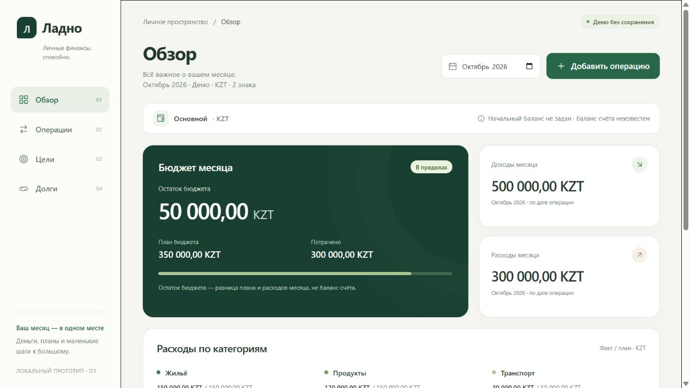
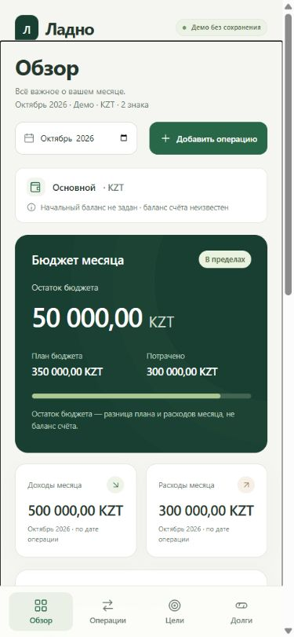

# APP-003 — независимая сценарная browser QA

Дата: 02.11.2026, Asia/Qyzylorda. Исполнитель: `/root/local_prototype_browser_qa`, scenario-test-engineer от имени `/root/personal_finance_qa` (qa-lead). Специалист не утверждает себя; проверка главы и суд — следующие этапы.
Версия: `local-prototype-v1`, `team/snapshots/local-prototype-v1.json`, 46 файлов; digest `be7ef8f3e912744b04804a7a225fdee44ad6917254de68529f97a2af728e354e`.
Владение: этот отчёт и новые `APP-003-qa-proofs/*.jpg`. Продукт/frozen-документы, сервер и чужие вкладки не менялись. Старый blocked-этап сохранён отдельно в `APP-003-qa-scenarios-blocked.md`; его попытки не называются runtime-тестами.

## Основания и среда

Прочитаны AGENTS.md, team/PROTOCOL.md, полный профиль scenario-test-engineer, APP-003, LOCAL-PROTOTYPE, SCREENS, MODEL, frontend/HEAD_REVIEW с ограничениями и computer-use skill. Ожидания — требования/D1: октябрь 2026, цели/долги на 30.10.2026, KZT/2; лишняя точность отклоняется без округления.
Первый CUA-вызов: `var tab = await cua.createBrowserTab('iab','http://127.0.0.1:8766/',{visible:false});` — реально создана собственная скрытая вкладка 1, D1 загружен. IAB нового контекста работал штатно.
Все UI-действия только `mcp__cua_repl`: клики/ввод/select/клавиши/reload/screenshots/viewport capability. Evaluate — только чтение DOM/фокуса/геометрии; скрытые globals не читались. Figma/file://, shell Playwright и другие surfaces не использовались.

## Выполненное — шаги, ожидание и факт

- **UI-01 / P1,P4, pass.** Открыть URL → Обзор. Ожидание/факт совпали: доход 500 000,00, расход 300 000,00, план 350 000,00, остаток бюджета 50 000,00 KZT; цель 180 000,00 из 600 000,00 /30%; долги 80 000,00 и 50 000,00 отдельно. Видны «Начальный баланс не задан · баланс счёта неизвестен», демо/память/период/KZT/2 знака. Остаток явно не баланс.
- **UI-02 / P1,P2, pass.** Через четыре кнопки открыть Обзор/Операции/Цели/Долги. Русские разделы и соответствующие CTA работают; Мне должны показывает Пример Б/50 000,00 отдельно. Реально использованы боковая desktop- и нижняя mobile-навигация.
- **UI-03 / P2, pass.** Операции → Переводы: «По этим фильтрам ничего нет», CTA Сбросить фильтры; месячные 500 000,00/300 000,00/50 000,00 прежние. Сброс вернул Все и четыре строкиD1.
- **UI-04 / P3, pass.** Новая операция: Расход, `1200,999`, `2026-10-12`, Основной, Продукты, заметка `QA raw precision` → submit. Ожидалось отклонение без округления/пятой записи. Факт: «Не более 2 знаков после запятой», все поля сохранены, фокус на сумме; DOM-таблица за modal содержит ровно четыре исходные записи.
- **UI-05 / P3,P4, pass.** Исправить только сумму на`1200,99` → submit: ровно пятая строка −1 200,99 с датой/категорией/заметкой; расход 301 200,99, остаток 48 799,01 KZT, доход прежний. Фокус вернулся к Добавить операцию.
- **UI-06 / P3,P4, pass.** Новая операция → Доход: категория обновилась на Зарплату. `0,01`, `2026-10-31` → submit: шестая строка +0,01; доход 500 000,01, расход 301 200,99/остаток 48 799,01 KZT прежние.
- **UI-07 / P3, pass.** В новой форме последовательно submit суммы пусто,`0`,`-1`: ошибки «Введите сумму»/«Введите сумму больше 0», raw остаётся. Затем сумма`1`, дата`2026-02-29` → «Укажите существующую дату…», дата сохранена, фокус на дате. После закрытия история всё ещё 6 строк, суммы прежние.
- **UI-08 / P3, pass.** Тип Перевод: единственный Основной и причина «Для перевода нужны два разных счёта… В демо доступен один счёт. Перевод сохранить нельзя»; submit disabled, `isEnabled()=false`. Escape закрыл форму и вернул фокус к вызвавшей кнопке.
- **UI-09 / P4, pass.** Цели → Изменить накопленное →`180000,01` → submit:180 000,01. Создать цель `QA отпуск`, target`1000,00`, accumulated`250,00` → submit: новая карточка 250,00 из 1 000,00/25%, исходная сохранена.
- **UI-10 / P4, pass.** Записать долг: Я должен, `QA новый долг`, `100,01`, срок`2026-11-15` → submit: новая карточка 100,01, итог 80 100,01; Мне должны 50 000,00 KZT прежнее.
- **UI-11 / P4, pass.** Возврат нового долга`100,02` на`2026-10-30`: ошибка переплаты с остатком 100,01, raw сумма/дата сохранены. Исправить на`100,01` → submit: карточка 0,00/Погашен, CTA «Долг погашен» disabled (`isEnabled()=false`), итог Я должен 80 000,00.
- **UI-12 / P4, pass.** Пример А → возврат`0,01` на`2026-10-30` →79 999,99; встречное направление 50 000,00. После UI-09–12 Операции: те же 6 строк/500 000,01/301 200,99/48 799,01. Обзор: цель 180 000,01, долги 79 999,99/50 000,00, баланс неизвестен. Ручной учёт не создал ledger-эффекта.
- **UI-13 / P2, pass в Обзоре.** Toolbar Загрузка: явно подписанный образец, денежные данные не заменены нулями. Ошибка: объяснение образца/сохранённой памяти → Повторить вернул изменённые суммы/цель/долги. Пусто: «Бюджет не настроен», неизвестный план/остаток не равен нулю. Данные возвращает содержимое.
- **UI-14 / P5, pass для reset/reload.** Сброс после изменений → D1/четыре операции. На mobile добавить расход`0,01`,`2026-11-01`,Транспорт → одна ноябрьская строка, доход 0,00/расход 0,01/остаток«—», выбран ноябрь. Reload → Обзор/октябрь/D1; снова проверены четыре строки октября. Финальные reset+reload перед proofs.
- **UI-15 / P1, pass в проверенных состояниях.** Desktop inner 1280×720; во всех 4 разделах clientWidth=scrollWidth=1265. Viewport override 390×844; во всех 4 разделах clientWidth=scrollWidth=375. Лично просмотрены screenshots всех 4desktop/mobile: суммы/подписи/основные кнопки без горизонтальной обрезки; нижние строки mobile-операций просмотрены обычной прокруткой. Вертикальная прокрутка штатная.
- **UI-16 / P1,P3, pass адресно.** Mobile-форма операции просмотрена: поля/заметка/submit доступны, clientWidth=scrollWidth=390; ноябрьская операция реально отправлена. Desktop-dialog открывается с фокусом heading, invalid фокусирует поле. В форме нового долга Shift+Tab от heading → последний submit; Tab → Закрыть форму. AX открытого modal не предоставляет фон для взаимодействия. Escape/возврат фокуса — UI-08.

## Доказательства версии и снимки

После прогона read-only `node -e` прочитал manifest/SHA-256 всех файлов и canonical digest: ordinal paths, UTF-8 `sha256 + два пробела + path + LF`. Ожидались 46 совпадений/digest версии; факт exit 0: `{"files":46,"changed":[],"digest":"be7ef8f3e912744b04804a7a225fdee44ad6917254de68529f97a2af728e354e"}`. Это целостность, не UI-тест.
Два собственных JPEG D1 после reset/reload сохранены `tab.getScreenshot()` и затем лично открыты `view_image`. Снимки viewport, не вся прокручиваемая страница:

- `APP-003-qa-proofs/overview-desktop.jpg`: SHA-256 `920572a1af31ae92e0042922e88e6079e270b8ea2444dac8ba32f5f1c71b8b50`.
- `APP-003-qa-proofs/overview-390.jpg`: SHA-256 `b6bd63fea20f1fc19cd43cbacd2d4997e77b884bb9ceeac45a324c31a44339e2`.

`tab.dev.logs({levels:['error','warn'],limit:100})` вернул `[]` за этот прогон; это не сетевой trace.

## Замечания, ограничения и вопросы

Подтверждённых продуктовых дефектов P0–P3 в выполненных сценариях не обнаружено; это не утверждение отсутствия всех дефектов. Прежний `QA-UI-ENV-01` относился к другим контекстам; обязательный browser-этап здесь выполнен.
Инструментальные ошибки: первый locator назвал AX-контрол Переводы checkbox; DOM показал button, после свежего DOM использован button. Full-page screenshot вернул «Unable to capture screenshot»; использованы viewport-снимки и прокрутка. Это не дефекты продукта.
**Не выполнялось:** actual offline-disconnect/загрузка при отключённой сети; file://; огромная exact-сумма в UI 390 px; все возможные отрицательные/огромные inputs и даты; empty/loading/error отдельно в остальных 3 разделах; cross-browser/прочие ширины/реальные мобильные устройства. Node-проверки коллеги не присваиваются этому отчёту.
P1–P4 имеют перечисленные browser-доказательства. P5 подтверждён для loopback/reset/reload/целостности, фактический offline непроверен. P6: независимый сценарный этап выполнен, проверка qa-lead/суд требуются. Демо не утверждает будущую платформу/хранение/Q-02–04.

## Передача

`viewport.reset()` выполнен; отдельное последующее DOM-чтение подтвердило inner 1280×720/client=scroll=1265/scrollY=0. Моя вкладка 1 закрыта; root tab4/сервер не затронуты. Перед закрытием исходныйD1.
Следующее действие: qa-lead проверяет этот отчёт и QA proofs, объединяет с независимыми расчётами и возвращает root вывод для суда по неизменной версии. Приёмку специалист не объявляет.

